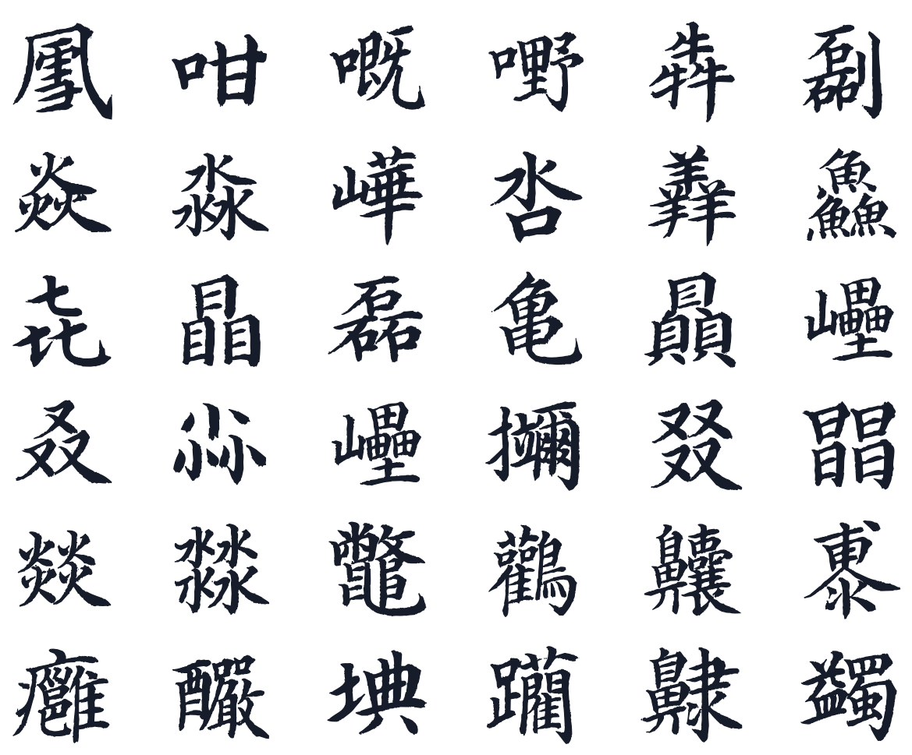

# F2A-FourBook

A regular-weight Chinese kai-style font generated with **Font2Art’s Nova 3.0** AI model, based on the Ming-dynasty manuscript *Sishu Baiwen* (《四書白文》).

**Made by [Font2Art Limited](https://font2.art)**  
Website: [https://font2.art](https://font2.art)

## Demo

## Character coverage

The font covers **CJK Unified Ideographs** (Basic), **CJK Unified Ideographs Extension A**, and **CJK Unified Ideographs Extension C**, plus numerals and symbols — **33,834 characters** in total.

## Files

| File | Format |
| --- | --- |
| `fonts/F2A FourBook-Regular.ttf` | TrueType |
| `fonts/F2A FourBook-Regular.woff` | WOFF |
| `fonts/F2A FourBook-Regular.woff2` | WOFF2 |

Reserved Font Name: **F2A-FourBook**.

## Source

此部明代精寫本《四書白文》現典藏於日本宮內廳書陵部，全書雖無書寫者落款，但憑藉卷末明代名家的題跋與書匣題簽，歷來被認定為明代書法名家姜立綱（1444－1499）的真跡。

### 歷史與編纂背景

此《四書白文》舊傳為明代書家姜立綱手書。全書共十八卷，包含儒家經典：《論語》二卷、《大學》一卷、《中庸》一卷、《孟子》十四卷，全文大字楷書，朱色句讀。此為明代精寫本，開本闊大，書末有王世貞、趙用賢跋，現藏於日本宮內廳書陵部。

此書未題書寫人。卷末王世貞跋認為此書是進供給春宮 [ 1 ] 皇太子的讀本。初見此字時，王世貞以為是明代大書家沈度所書，之後在波磔處察覺到沈度所沒有的鋒芒，確定此書為姜立綱所筆。

最後趙用賢跋提及此書原為張幼於所藏，經王世貞（弇山先生）鑑定為姜立綱真跡。

## License

This Font Software is licensed under the **SIL Open Font License, Version 1.1** (OFL 1.1). See [`OFL.txt`](OFL.txt).

You may use, study, embed, modify, and redistribute the font, including in commercial work, as long as:

- the font is not sold by itself
- modified versions keep the OFL
- modified versions do not use the reserved name **F2A-FourBook** without permission

Fallback Latin/symbol coverage is derived from a modified **Droid Sans Fallback**, licensed under the Apache License 2.0. See [`LICENSE_DroidSansFallback.txt`](LICENSE_DroidSansFallback.txt).

## Acknowledgements

感謝 [書格](https://www.shuge.org/view/si_shu_bai_wen/) 公開分享《四書白文》數字影像，作為本字體訓練與風格參考的引文來源：

> [https://www.shuge.org/view/si_shu_bai_wen/](https://www.shuge.org/view/si_shu_bai_wen/)

The original manuscript is held by the Imperial Household Agency, Archives and Mausolea Department (宮內廳書陵部), Japan. Digital presentation on Shuge is credited here as the source we used; rights in the physical object remain with the holding institution.
